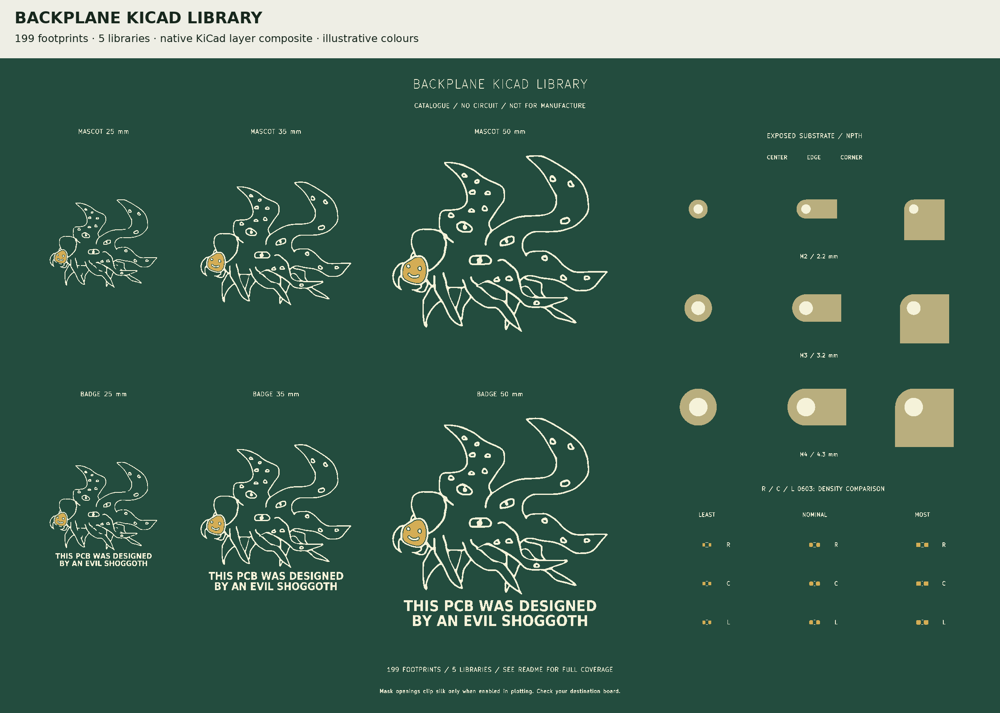

# Backplane KiCad Library

Reusable KiCad mounting holes with copper keepouts and mask-based silk clearance,
Backplane logos, Shoggoth artwork, and passives in least, nominal, and most IPC material settings.

**223 footprints · 42 STEP models**

[Install and use](docs/library-guide.md) · [Verification](docs/verification.md) · [Licenses](LICENSES.md)

The original 35 mm Shoggoth is preserved; mascot and caption badges also come
in nominal 25 and 50 mm sizes. Backplane logos (mark, and mark with wordmark) come
in front silk, back silk and copper/mask versions, 3 to 30 mm: see [logos](docs/logo.md)
and the [logo sheet](previews/logo/logo-sheet.png). Source generators, configurations, and provenance
are included.
